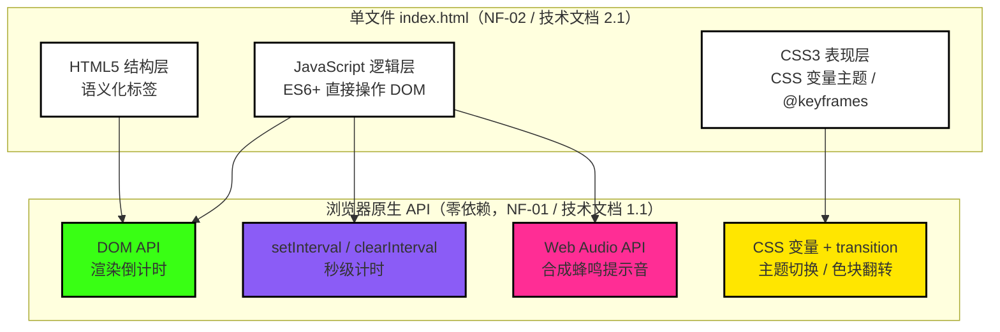
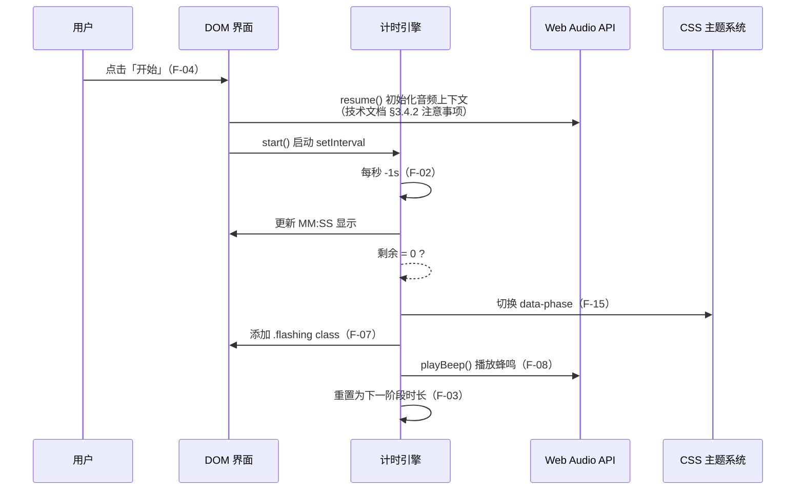
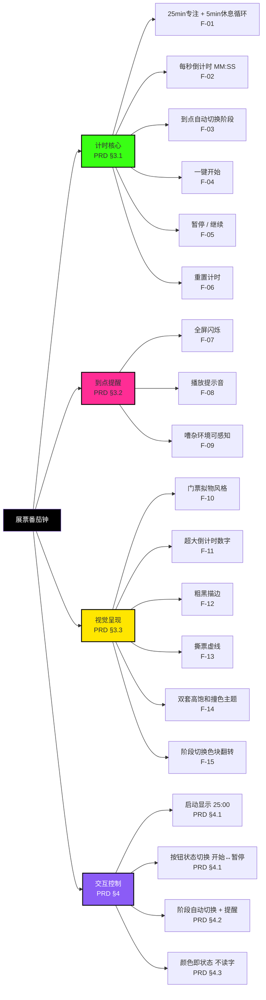
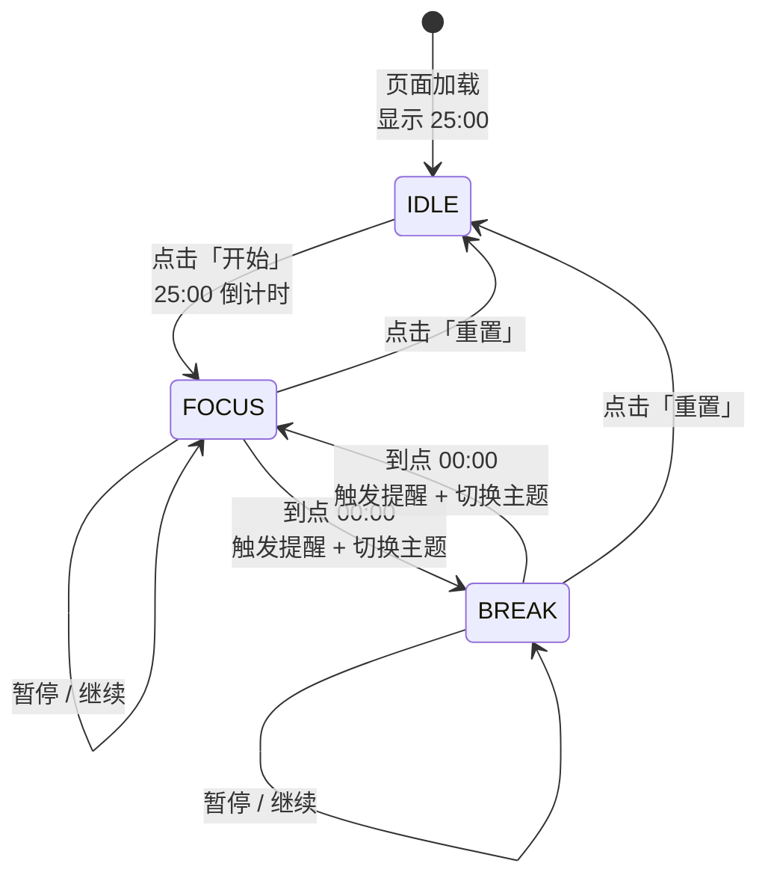

# 展票番茄钟 · 架构设计

> 本文档中的所有设计均已核对 [PRD.md](file:///e:/Desktop/demo01/PRD.md) 与 [技术需求文档.md](file:///e:/Desktop/demo01/技术需求文档.md)，每一项标注了对应的需求来源。

---

## 一、技术架构图

### 1.1 分层架构总览



### 1.2 技术栈映射表

| 架构层 | 技术选型 | 对应文档 |
|--------|----------|----------|
| 结构层 | 原生 HTML5 | 技术文档 §1.1 |
| 表现层 | 原生 CSS3（CSS 变量 / `@keyframes` / `clamp()`） | 技术文档 §1.1、§3.1、§3.2 |
| 逻辑层 | 原生 JavaScript（ES6+） | 技术文档 §1.1、§3.3 |
| 音频 | Web Audio API（`AudioContext` + `OscillatorNode`） | 技术文档 §3.4.2 |
| 计时 | `setInterval` / `clearInterval` | 技术文档 §3.3 |
| 构建 | 无（单文件双击运行） | PRD NF-03 / 技术文档 §1.1 |

### 1.3 数据流



---

## 二、功能架构图

### 2.1 功能模块总览



### 2.2 计时状态机（对应技术文档 §3.3）



---

## 三、项目骨架结构

### 3.1 文件树

```
demo01/
├── index.html              ← 唯一运行文件（NF-02）
├── PRD.md                  ← 产品需求文档
├── 技术需求文档.md          ← 技术需求文档
└── 架构设计.md              ← 本文档
```

> ✅ 核对：仅 `index.html` 一个运行文件，符合 PRD NF-02「单文件」与技术文档 §2.1。

### 3.2 `index.html` 内部骨架

```html
<!DOCTYPE html>
<html lang="zh-CN">
<head>
    <!-- ============================================ -->
    <!-- 元信息（对应技术文档 §四 移动端适配）          -->
    <!-- ============================================ -->
    <meta charset="UTF-8">
    <meta name="viewport" content="width=device-width, initial-scale=1">
    <title>展票番茄钟</title>

    <style>
        /* ================================================ */
        /* 1. CSS 变量主题系统（技术文档 §3.1）              */
        /*    :root 默认 = 专注主题（荧光绿/亮紫/亮橙）        */
        /*    body[data-phase="break"] = 休息主题（热粉/亮黄/亮青）*/
        /* ================================================ */
        :root {
            --bg-primary: #39FF14;   /* 专注：荧光绿 */
            --bg-secondary: #8B5CF6;  /* 专注：亮紫 */
            --bg-tertiary: #FF6B35;   /* 专注：亮橙 */
            --ticket-bg: #FFFFFF;
            --ink: #000000;
        }
        body[data-phase="break"] {
            --bg-primary: #FF2D95;   /* 休息：热粉 */
            --bg-secondary: #FFE600;  /* 休息：亮黄 */
            --bg-tertiary: #00E5FF;   /* 休息：亮青 */
        }

        /* 2. 全局重置 + 移动端视口（100dvh，技术文档 §四） */
        /*    背景：linear-gradient 多色拼接（多巴胺风）      */
        /* 3. 门票样式：粗黑描边 + 撕票虚线（技术文档 §3.2） */
        /* 4. 超大倒计时数字：clamp(64px,22vw,116px) + var(--bg-secondary) 填充 + 4px 描边（PRD §5.3） */
        /* 5. 闪烁动画 @keyframes flash（技术文档 §3.4.1） */
        /*    + @media prefers-reduced-motion 降级为单次淡入 */
        /* 6. 色块翻转 transition（技术文档 §3.5） */
    </style>
</head>
<body data-phase="focus">
    <!-- ================================================ -->
    <!-- 门票 DOM 结构（PRD §5.2 门票结构）                 -->
    <!-- ================================================ -->
    <main class="ticket">
        <!-- 票头：阶段标识（专注 / 休息） -->
        <header class="ticket__header">
            <span class="ticket__phase">FOCUS</span>
        </header>

        <!-- 票身：超大倒计时数字（F-11，含 aria-live） -->
        <div class="ticket__countdown" id="countdown" aria-live="polite">25:00</div>

        <!-- 撕票虚线（F-13） -->
        <div class="ticket__divider"></div>

        <!-- 票根：计数器 + 控制按钮 -->
        <div class="ticket__counter" id="counter">今日已完成 0 段</div>
        <footer class="ticket__controls">
            <button id="startBtn" class="btn btn--primary" aria-label="开始或暂停计时">开始</button>
            <button id="resetBtn" class="btn btn--ghost" aria-label="重置计时">重置</button>
        </footer>
    </main>

    <script>
        /* ================================================ */
        /* 1. 状态管理                                        */
        /*    - phase: 'focus' | 'break'                      */
        /*    - remaining: 剩余秒数                            */
        /*    - isRunning: 是否运行中                          */
        /*    - timerId: setInterval 返回值                    */
        /* ================================================ */

        /* 2. 配置常量                                        */
        /*    - FOCUS_DURATION = 25 * 60                      */
        /*    - BREAK_DURATION = 5 * 60                       */

        /* 3. 计时引擎（技术文档 §3.3）                        */
        /*    - startTimer(): setInterval 每秒 -1              */
        /*    - tick(): 递减 + 渲染 + 到点判断                  */
        /*    - pauseTimer(): clearInterval                    */
        /*    - resetTimer(): 回到 IDLE                        */
        /*    - switchPhase(): 专注↔休息 自动切换（F-03）       */

        /* 4. 音频模块（技术文档 §3.4.2）                      */
        /*    - initAudio(): 用户首次交互时 resume()           */
        /*    - playBeep(): 880Hz square 0.3s × 3 次           */

        /* 5. 视觉提醒（技术文档 §3.4.1）                      */
        /*    - triggerFlash(): body 添加 .flashing            */

        /* 6. UI 渲染                                         */
        /*    - renderCountdown(): MM:SS 格式化                */
        /*    - renderPhase(): 切换 data-phase + 按钮文案       */

        /* 7. 事件绑定（PRD §4 交互）                          */
        /*    - startBtn: touchstart/click → start/pause       */
        /*    - resetBtn: touchstart/click → reset             */
    </script>
</body>
</html>
```

### 3.3 JS 模块职责划分

| 模块 | 职责 | 对应需求 |
|------|------|----------|
| **状态管理** | 维护 `phase` / `remaining` / `isRunning` | 全局 |
| **计时引擎** | `setInterval` 驱动、到点切换 | F-01、F-02、F-03 |
| **音频模块** | Web Audio API 合成蜂鸣，交互时初始化 | F-08、F-09 |
| **视觉提醒** | 全屏闪烁 class 切换 | F-07 |
| **UI 渲染** | 倒计时格式化、主题切换、按钮状态 | F-11、F-14、F-15 |
| **事件绑定** | 开始/暂停/重置的触摸与点击事件 | F-04、F-05、F-06 |

---

## 四、设计核对清单

每一项均已与两份文档交叉核对：

| 核对项 | 状态 | 依据 |
|--------|------|------|
| 单文件零依赖 | ✅ | PRD NF-01 / NF-02，技术文档 §1.1 |
| 25+5 循环计时 | ✅ | PRD F-01，技术文档 §3.3 状态机 |
| 到点闪烁+声音 | ✅ | PRD F-07 / F-08，技术文档 §3.4 |
| 门票拟物视觉 | ✅ | PRD F-10~F-13，技术文档 §3.2 |
| 双套撞色主题 | ✅ | PRD F-14 / §5.1，技术文档 §3.1 |
| 色块翻转 | ✅ | PRD F-15，技术文档 §3.5 |
| AudioContext 交互初始化 | ✅ | 技术文档 §3.4.2 ⚠️注意事项 |
| 移动端 100dvh + touchstart | ✅ | 技术文档 §四 |
| 无构建工具 | ✅ | 技术文档 §1.1 |
